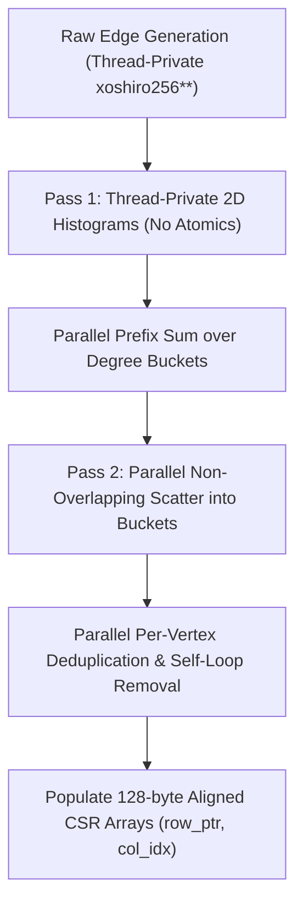

# OpenMP Parallel BFS: Phase 0 & Phase 1 Summary

> **Project Goal:** High-performance, level-synchronous parallel Breadth-First Search (BFS) on large-scale power-law (scale-free) graphs using OpenMP. The primary objective is to scale across multi-core SMP and NUMA architectures by systematically eliminating atomic contention, false sharing, and cache-line invalidation traffic.

---

## 1. Executive Overview

Breadth-First Search on scale-free graphs (such as web graphs, social networks, and Kronecker/R-MAT graphs) is notoriously **memory-bandwidth bound and irregular**. Hub vertices with degrees in the thousands or millions cause severe concurrency bottlenecks:
- **True Atomic Contention:** Thousands of concurrent threads attempt to claim unvisited vertices and increment shared queue indices simultaneously.
- **Cache Ping-Ponging & RFO Storms:** Under cache coherence protocols (MESI/MOESI), write operations require *Read-For-Ownership (RFO)* broadcasts, constantly invalidating L1/L2 caches and causing lines to bounce between CPU cores.
- **False Sharing:** Independent variables accessed by distinct threads accidentally mapped into the same cache line trigger unnecessary cache invalidations even when threads do not access the same data.

**Phases 0 and 1** establish the foundational architecture, empirical hardware baseline, and high-performance graph generation engine required for all subsequent BFS traversal implementations.

---

## 2. Phase 0: Hardware Topology, Cache Coherence & Atomic Contention

### Architectural Baseline & Hardware Profile
The host development node was profiled and benchmarked, contrasting modern ARM architectures with server-grade x86-64 NUMA nodes:

| Feature | Development Host (Apple Silicon M1) | Server Target (x86-64 SMP/NUMA) |
| :--- | :--- | :--- |
| **Architecture** | ARMv8.5-A (4 Firestorm P-cores + 4 Icestorm E-cores) | Intel Xeon / AMD EPYC (symmetric cores) |
| **Cache Line Size** | **128 bytes** | **64 bytes** |
| **Memory Model** | Weakly ordered memory model (`LDAR`/`STLR`) | Total Store Order (TSO) (`lock` instructions) |
| **Cache Coherence** | Point-to-point coherent fabric linking clusters | Snooping / Directory-based MESI/MOESI/MESIF |
| **Alignment Constraint**| **Must align to 128 bytes** to prevent false sharing | 64-byte alignment |

> **Key Architectural Insight:** Apple Silicon uses **128-byte cache lines**. Aligning structures only to standard 64 bytes results in subtle false sharing across adjacent halves. Thus, the codebase enforces `CACHE_LINE_SIZE = 128` bytes universally (`utils::aligned_malloc` and `alignas(128)`).

---

### Empirical Microbenchmark (`bin/atomic_microbench`)
To quantify the exact cost of atomic operations, coherence traffic, and false sharing, an OpenMP microbenchmark evaluates four execution patterns across 1, 2, 4, and 8 threads:

1. **Uncontended (Padded):** Each thread exclusively updates its own 128-byte padded atomic counter.
2. **False Sharing (Unpadded):** Threads update adjacent, unpadded atomic variables tightly packed within the same cache line.
3. **Contended Atomic `fetch_add`:** All threads concurrently hammer a single shared atomic counter (both `relaxed` and `seq_cst`).
4. **Contended CAS Loop:** Threads repeatedly attempt `compare_exchange_weak` on a single shared counter.

#### Benchmark Results (Apple M1, 8 Threads)
```text
=====================================================================================
Benchmark Mode                Threads   Total Ops       Time (s)      Latency (ns)   
=====================================================================================
Uncontended (Padded)          1         20,000,000      0.1444        7.22           
False Sharing (Unpadded)      1         20,000,000      0.1505        7.52           
Contended (fetch_add relaxed) 1         20,000,000      0.1388        6.94           
Contended CAS loop            1         20,000,000      0.0466        2.33           
-------------------------------------------------------------------------------------
Uncontended (Padded)          8         160,000,000     0.2726        1.70           
False Sharing (Unpadded)      8         160,000,000     4.8638        30.40  (17.8x penalty)
Contended (fetch_add relaxed) 8         20,000,000      0.8142        40.71  (23.9x penalty)
Contended (fetch_add seq_cst) 8         20,000,000      0.8127        40.64  (23.9x penalty)
Contended CAS loop            8         20,000,000      1.0313        51.57  (30.3x penalty)
=====================================================================================
```

#### Microbenchmark Takeaways
- **Zero-overhead scaling when padded:** Uncontended padded counters scale almost linearly (throughput jumps from 138M to 587M ops/s; latency drops to 1.70 ns).
- **False sharing is devastating:** At 8 threads, false sharing on unpadded variables causes a **17.8x latency surge** (from 1.7 ns to 30.4 ns) solely due to coherence line invalidations.
- **Atomic contention ruins throughput:** Contended atomic additions and CAS loops add a **24x to 30x latency penalty**, proving why naive parallel BFS (which atomicity-locks global queue tails) fails to scale.

---

## 3. Phase 1: Synthetic Graph Generation & CSR Representation

Phase 1 provides a fully parallel, contention-free graph generator and an optimized, 128-byte aligned Compressed Sparse Row (CSR) storage format.

### 1. Synthetic Graph Generators
- **Kronecker / R-MAT (Graph500 standard):**
  - Parameterized by `SCALE` ($N = 2^{\text{SCALE}}$ vertices) and `edge_factor` ($M = \text{edge\_factor} \times N$).
  - Standard Graph500 quadrant probabilities: $a=0.57$, $b=0.19$, $c=0.19$, $d=0.05$.
  - Thread-private PRNG using **`xoshiro256**`** with independent jump offsets, completely avoiding thread contention on random number generators.
  - Generates realistic power-law degree distributions with extreme hub skew (e.g., Gini coefficient $> 0.70$).
- **Barabási-Albert (BA) Preferential Attachment:**
  - Generates scale-free networks via preferential attachment with uniform degree distribution verification.

---

### 2. Contention-Free Parallel CSR Construction
Naive CSR construction can introduce massive atomic overhead when threads append edges to shared vertex lists. To maintain maximum throughput, the generator implements a **two-pass parallel counting sort and scatter**:



1. **Thread-Private Histograms:** Each thread builds private local vertex degree counts with **zero atomics**.
2. **Parallel Prefix Sum:** Degree sums across threads determine the exact offsets for each vertex in the global array.
3. **Partitioned Edge Scatter:** Threads scatter directed symmetric edges $(u, v)$ and $(v, u)$ into non-overlapping memory ranges.
4. **Parallel Sort & Deduplication:** Neighbor lists for each vertex are sorted in parallel; duplicate edges and self-loops are purged.
5. **128-Byte Aligned Allocation:** `row_ptr` and `col_idx` are allocated via `posix_memalign` with strict 128-byte cache-line boundaries.

---

### 3. Memory Layout & Compact Binary Serialization
- **32-Bit Vertex IDs (`uint32_t`):** Allows graphs up to $4.29 \times 10^9$ vertices while reducing memory footprint and bandwidth pressure by 50% compared to 64-bit representations.
- **64-Bit Edge Offsets (`uint64_t`):** Prevents offset overflow on large graphs with billions of edges.
- **Compact Binary Format (`.bin`):** Stores a header (`num_vertices`, `num_edges`), followed by raw `row_ptr` and `col_idx` dumps for instantaneous load/save with zero parsing overhead.

---

### 4. Graph Properties & Validation (SCALE 16 Example)
Generated graphs pass rigorous structural validation (symmetry, absence of duplicates and self-loops, and power-law distribution):
- **Vertices:** 65,536 ($2^{16}$)
- **Directed CSR Edges:** 1,577,414 (undirected edges: ~788,707)
- **Min Degree:** 0 (isolated vertices accounted for)
- **Max Degree (Hub):** 11,466 (a single hub connects to ~17.5% of the entire graph)
- **Average Degree:** 24.07
- **Gini Coefficient:** 0.7417 (indicating extreme degree inequality characteristic of real-world scale-free networks)

---

## 4. Codebase Architecture

```text
CAO_project/
├── include/
│   ├── atomic_bench.hpp     # Microbenchmark suite for atomic contention & false sharing
│   ├── graph.hpp            # 128-byte aligned CSRGraph class and DegreeStats
│   ├── rmat_generator.hpp   # R-MAT and Barabási-Albert parallel generator declarations
│   └── utils.hpp            # Aligned allocator, Timer, and Xoshiro256** PRNG
├── src/
│   ├── benchmarks/
│   │   └── atomic_microbench.cpp  # Phase 0 atomic microbenchmark executable
│   ├── graph/
│   │   ├── graph.cpp              # CSR allocation, validation, degree stats, binary I/O
│   │   └── rmat_generator.cpp     # Parallel R-MAT generation & counting-sort CSR builder
│   └── tools/
│       ├── generate_graph.cpp     # CLI tool to generate and export synthetic graphs
│       └── inspect_graph.cpp      # CLI tool to inspect, validate, and summarize graphs
├── tests/
│   └── test_graph.cpp       # Unit test suite verifying alignment, deduplication & BA
├── scripts/
│   ├── plot_degree_dist.py  # Python script generating log-log power-law degree plots
│   └── run_phase0_phase1.sh # End-to-end automated verification pipeline
├── docs/
│   └── hardware_profile.md  # Comprehensive hardware topology and cache coherence study
├── data/                    # Generated .bin graphs, degree CSVs, and distribution plots
├── Makefile                 # Optimized OpenMP C++17 build configuration
└── IMPLEMENTATION_PLAN.md   # Complete 10-phase master implementation roadmap
```

---

## 5. Quickstart & Verification Commands

### Build Everything
```bash
make all
```

### Run Unit & Structural Tests
```bash
make test
# or: ./bin/test_graph
```
*Validates 128-byte pointer alignment, toy graph deduplication, R-MAT symmetry, binary I/O round-trip, and BA generator integrity.*

### Run Phase 0 Atomic Microbenchmark
```bash
make microbench
# or: ./bin/atomic_microbench
```

### Generate & Inspect a Scale-Free Graph
```bash
# Generate SCALE 16 R-MAT graph (65,536 vertices, edge-factor 16)
./bin/generate_graph --scale 16 --edge-factor 16 --output data/rmat_s16.bin --csv data/rmat_s16_deg.csv --validate

# Inspect and print graph statistics
./bin/inspect_graph data/rmat_s16.bin --validate

# Plot power-law degree distribution
python3 scripts/plot_degree_dist.py --csv data/rmat_s16_deg.csv --output data/rmat_s16_power_law.png
```

### Run Full End-to-End Pipeline
```bash
./scripts/run_phase0_phase1.sh
```

---

## 6. Next Steps: Roadmap to Phase 2 and Beyond

With the hardware profile, contention baseline, and graph generation engine complete, the project is ready for **Phase 2 and Phase 3**:
- **Phase 2 (Serial & Naive OpenMP BFS):** Implement flat-queue serial BFS (correctness oracle) and naive level-synchronous OpenMP BFS (shared atomic queue tail and CAS distance claims).
- **Phase 3 (Profiling the Bottlenecks):** Collect hardware counter profiles (`perf stat`, `perf c2c` HITM events) to empirically quantify the cache invalidation bottleneck during BFS traversal.
- **Phases 4–6 (Optimizations):** Introduce test-before-CAS, thread-local frontier buffers, visited bitmaps, 128-byte cache-line padding, and Beamer direction-optimizing traversal (top-down / bottom-up).
