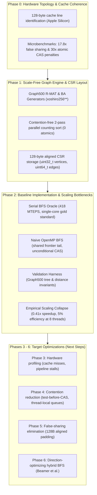
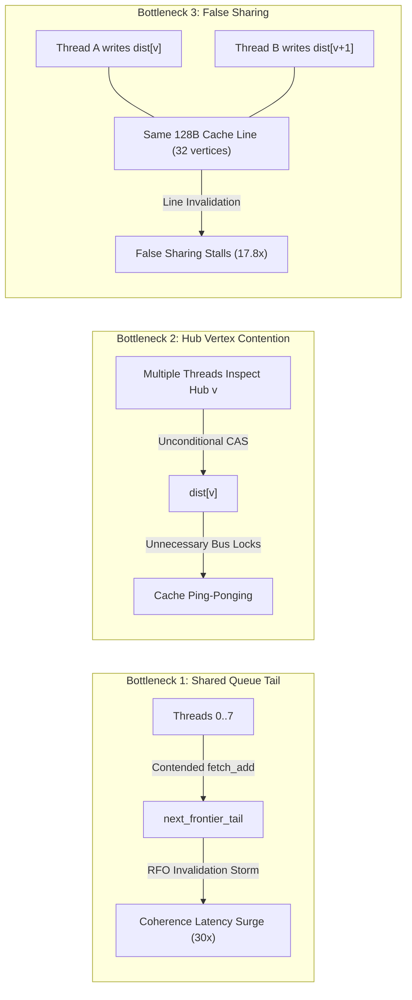

# OpenMP Parallel BFS: Phase 2 Summary & Multi-Phase Evolution

> **Project Mission:** High-performance, level-synchronous parallel Breadth-First Search (BFS) on large-scale power-law (scale-free) graphs using OpenMP. The objective of Phase 2 is to establish the ground-truth correctness oracle, implement the baseline level-synchronous parallel BFS, validate structural invariants, and empirically quantify the multi-threaded scaling bottlenecks caused by atomic contention and cache coherence traffic.

---

## 1. Multi-Phase Evolution: From Hardware Physics to Baseline Collapse

The project follows a structured progression where each phase uncovers the architectural constraints and builds the components needed for subsequent optimization:



### Evolution Summary Matrix

| Phase | Core Objective | Key Implementation | Architectural Insight / Discovery | Output / Milestone |
| :--- | :--- | :--- | :--- | :--- |
| **Phase 0** | Hardware topology & atomic cost profiling | `atomic_microbench` measuring uncontended, false-sharing, and contended atomic operations | Apple Silicon uses **128-byte cache lines**. False sharing imposes a **17.8x latency penalty**; contended CAS imposes a **30.3x penalty**. | Hardware profile report & baseline alignment contract (`CACHE_LINE_SIZE = 128`). |
| **Phase 1** | Scale-free graph generation & CSR storage | Contention-free parallel R-MAT generator; 128B-aligned CSR memory layout | Scale-free graphs feature extreme hub skew (Gini > 0.74, hub degree > 10,000). Graph construction requires thread-private histograms to avoid atomic contention. | High-throughput synthetic graph generator & compact `.bin` CSR binary format. |
| **Phase 2** | Oracle baseline & naive parallel evaluation | Serial BFS oracle; Naive OpenMP BFS; Graph500 validation harness; scaling benchmark | **Naive parallel BFS is 2.4x slower than single-core serial BFS** (173 vs 418 MTEPS at 8 threads; 5% efficiency) due to queue tail serialization and hub CAS storms. | Baseline performance curves (`scaling_curve.png`), validated test harness (`test_bfs`). |
| **Phase 3+** *(Next)* | Root-cause profiling & bottleneck elimination | Direction-optimizing hybrid BFS, test-before-CAS, visited bitmaps, thread-local queues | Traversal must eliminate shared atomic queue tails and convert top-down hub writes into bottom-up unvisited reads. | High-efficiency parallel scaling on multi-core SMP/NUMA. |

---

## 2. Phase 0 Foundations in Short: Hardware & Coherence

Phase 0 profiled the development architecture (Apple Silicon M1: 4 Firestorm P-cores + 4 Icestorm E-cores) against enterprise x86-64 NUMA systems:
- **128-Byte Cache Lines:** Apple Silicon features 128-byte cache lines (vs. 64-byte on x86). Structures aligned only to 64 bytes suffer subtle false sharing across adjacent halves. All code enforces `alignas(128)`.
- **Empirical Microbenchmark:**
  - *Uncontended Padded:* Latency drops from 7.22 ns (1 thread) to **1.70 ns** (8 threads) — near-linear scaling.
  - *False Sharing (Unpadded):* Latency increases to **30.40 ns (17.8x penalty)** due to MESI/MOESI Read-For-Ownership (RFO) cache-line bouncing.
  - *Contended Atomic `fetch_add` / CAS:* Latency spikes to **40.71 ns – 51.57 ns (24x – 30x penalty)** due to bus serialization.

---

## 3. Phase 1 Foundations in Short: Scale-Free Graph Engine

Scale-free networks (Graph500 Kronecker/R-MAT, Barabási-Albert) have heavy-tailed degree distributions where a tiny fraction of hub vertices connect to a massive percentage of the graph.
- **Generator Design:** Parallel R-MAT generator ($a=0.57, b=0.19, c=0.19, d=0.05$) using thread-private `xoshiro256**` PRNGs with jump offsets (zero RNG locking).
- **Contention-Free CSR Construction:** Implements a two-pass parallel counting sort and scatter. Threads build local degree histograms, run parallel prefix sums, and scatter edges into disjoint memory partitions with **zero atomic operations**.
- **Compact Layout:** 32-bit vertex IDs (`uint32_t`) reduce bandwidth by 50% compared to 64-bit IDs; 64-bit edge offsets (`uint64_t`) prevent overflow; storage allocated with 128-byte alignment.

---

## 4. Phase 2 Architecture: Algorithms & Implementation

Phase 2 builds the baseline traversal implementations and the rigorous validation harness.

### 4.1 Serial BFS (Correctness Oracle)
- **Design:** Single-threaded flat-array circular queue with 128-byte aligned `dist[]`, `parent[]`, and `queue[]` arrays.
- **Properties:** Zero synchronization, zero atomics, pre-allocated memory. Delivers peak single-core throughput (**418.07 MTEPS**, 2.05 ms on SCALE 16 R-MAT).
- **Role:** Serves as the ground-truth oracle for verifying all parallel variants.

```cpp
// Serial BFS flat-array loop (src/bfs/serial_bfs.cpp)
while (head < tail) {
    uint32_t u = queue[head++];
    int32_t u_dist = result.dist[u];

    for (uint64_t e = g.row_ptr[u]; e < g.row_ptr[u + 1]; ++e) {
        uint32_t v = g.col_idx[e];
        if (result.dist[v] == -1) {
            result.dist[v] = u_dist + 1;
            if (track_parents) result.parent[v] = u;
            queue[tail++] = v;
        }
    }
}
```

### 4.2 Naive Level-Synchronous OpenMP BFS
- **Design:** Level-by-level frontier exploration parallelized via `#pragma omp parallel for schedule(dynamic, 64)`.
- **Synchronization Mechanisms:**
  1. *Unconditional Atomic CAS on `dist[v]`*: Every thread discovering neighbor $v$ issues an atomic CAS with `seq_cst` memory ordering:
     ```cpp
     int32_t expected = -1;
     if (__atomic_compare_exchange_n(&result.dist[v], &expected, current_level + 1,
                                     false, __ATOMIC_SEQ_CST, __ATOMIC_SEQ_CST)) {
         if (track_parents) result.parent[v] = u;
         uint64_t idx = next_frontier_tail.fetch_add(1, std::memory_order_seq_cst);
         next_frontier[idx] = v;
     }
     ```
  2. *Shared Queue Tail*: Discovered vertices are appended to a global `next_frontier` array using a shared atomic `fetch_add` on `next_frontier_tail`.
  3. *Level Synchronization*: Implicit OpenMP barrier synchronizes all threads before swapping frontiers for level $k + 1$.

### 4.3 Validation Harness & Invariants
Implemented in `bfs::validate_bfs` (`src/bfs/serial_bfs.cpp`), verifying:
1. **Distance Exactness:** BFS distance arrays must match the serial oracle identically: $\forall v, dist_{\text{parallel}}[v] == dist_{\text{oracle}}[v]$.
2. **Graph500 Tree Edge Invariants:**
   - Reachability: If $u$ is visited ($dist[u] \ge 0$), all neighbors $v$ must be visited ($dist[v] \ge 0$).
   - Distance consistency: $|dist[u] - dist[v]| \le 1$ for all reachable edges.
   - Parent pointer consistency: $dist[v] == dist[parent[v]] + 1$ with $parent[root] == root$.

---

## 5. Empirical Baseline Evaluation: The Scaling Collapse

### Experimental Setup
- **System:** Apple M1 (4 Firestorm P-cores + 4 Icestorm E-cores), 128-byte cache line size, 16 GB unified RAM.
- **Graph Workload:** R-MAT SCALE 16 ($N = 65,536$, $M = 1,820,258$ directed edges, Max degree $9,663$, Gini coefficient $0.8679$).
- **Protocol:** 16 randomly sampled source roots in the giant component; reported metric is the Graph500 harmonic mean Traversed Edges Per Second (TEPS).

### Benchmark Results

| Algorithm | Threads | Harmonic TEPS | MTEPS | Speedup vs Serial | Parallel Efficiency | Median Time |
| :--- | :---: | :---: | :---: | :---: | :---: | :---: |
| **Serial BFS (Oracle)** | 1 | $4.181 \times 10^8$ | **418.07** | **1.00x** | 100% | 2.056 ms |
| **Naive OpenMP BFS** | 1 | $1.713 \times 10^8$ | **171.33** | **0.41x** | 41.0% | 5.225 ms |
| **Naive OpenMP BFS** | 2 | $1.459 \times 10^8$ | **145.93** | **0.35x** | 17.5% | 6.112 ms |
| **Naive OpenMP BFS** | 4 | $1.923 \times 10^8$ | **192.27** | **0.46x** | 11.5% | 4.679 ms |
| **Naive OpenMP BFS** | 8 | $1.729 \times 10^8$ | **172.94** | **0.41x** | 5.2% | 5.250 ms |

```text
Throughput Comparison (MTEPS):
Serial (1T)  [==========================================] 418.07 MTEPS (Gold Standard)
Naive (1T)   [=================] 171.33 MTEPS
Naive (2T)   [==============   ] 145.93 MTEPS
Naive (4T)   [===================] 192.27 MTEPS
Naive (8T)   [=================] 172.94 MTEPS
```

### Why Naive Parallel BFS Fails: Physical Breakdown

The benchmark results confirm the project's central thesis: **naive multi-threading collapses on scale-free graphs due to the exact hardware bottlenecks exposed in Phase 0**:



1. **Shared Frontier Bottleneck:** Every claimed vertex requires an atomic `fetch_add` on `next_frontier_tail`. At peak levels where thousands of vertices are discovered, all 8 threads repeatedly fight over the single 128-byte cache line hosting the tail counter, causing severe coherence stalls.
2. **Hub Vertex CAS Storms:** Scale-free hubs have degree $>9,000$. Many threads concurrently inspect the same hub neighbors. In naive BFS, threads issue atomic compare-exchanges unconditionally without checking if `dist[v] != -1`, generating useless write invalidations.
3. **False Sharing across `dist[]`:** `dist[]` entries are 32-bit integers (`int32_t`), packing 32 vertices per 128-byte cache line. Threads updating distinct vertices that share a line trigger constant cross-core cache invalidations.
4. **Memory Order Penalties:** Using `__ATOMIC_SEQ_CST` introduces heavy pipeline flushes on ARM and bus locks on x86, degrading single-threaded parallel execution to 0.41x of serial speed.

---

## 6. Project Architecture

```text
CAO_project/
├── include/
│   ├── atomic_bench.hpp       # Phase 0: Microbenchmarks for atomic contention & false sharing
│   ├── bfs.hpp                # Phase 2: BFSResult, Serial BFS, Naive OpenMP BFS & validators
│   ├── graph.hpp              # Phase 1: 128-byte aligned CSRGraph class and DegreeStats
│   ├── rmat_generator.hpp     # Phase 1: R-MAT & Barabási-Albert parallel generator declarations
│   └── utils.hpp              # Aligned allocator (128B), high-res Timer, and Xoshiro256** PRNG
├── src/
│   ├── benchmarks/
│   │   └── atomic_microbench.cpp  # Phase 0: Microbenchmark executable
│   ├── bfs/
│   │   ├── naive_bfs.cpp          # Phase 2: Naive level-synchronous OpenMP BFS
│   │   └── serial_bfs.cpp         # Phase 2: Serial BFS correctness oracle & validator
│   ├── graph/
│   │   ├── graph.cpp              # Phase 1: CSR memory management, validation, binary I/O
│   │   └── rmat_generator.cpp     # Phase 1: Parallel counting-sort R-MAT builder (0 atomics)
│   └── tools/
│       ├── benchmark_bfs.cpp      # Phase 2: Multi-root BFS scaling benchmark harness (TEPS)
│       ├── generate_graph.cpp     # Phase 1: CLI graph generation and export utility
│       └── inspect_graph.cpp      # Phase 1: Graph topology & degree distribution analyzer
├── tests/
│   ├── test_bfs.cpp           # Phase 2: Test suite verifying BFS correctness vs oracle
│   └── test_graph.cpp         # Phase 1: Test suite verifying CSR alignment, degree stats & BA
├── scripts/
│   ├── plot_degree_dist.py    # Phase 1: Power-law log-log degree distribution plotter
│   ├── plot_scaling.py        # Phase 2: Strong-scaling & MTEPS curve plotter
│   ├── run_phase0_phase1.sh   # Phase 0 & Phase 1 verification pipeline
│   └── run_phase2.sh          # Phase 2 complete test, benchmark & plot pipeline
├── data/
│   ├── bfs_scaling.csv        # Phase 2: Benchmark scaling measurements
│   ├── scaling_curve.png      # Phase 2: Multi-threaded scaling curve plot
│   └── rmat_s16.bin           # Phase 1: SCALE 16 power-law benchmark graph
├── Makefile                   # C++17 OpenMP build system
├── CMakeLists.txt             # Cross-platform CMake configuration
├── README_PHASE1.md           # Documentation for Phase 0 & Phase 1
├── README_PHASE2.md           # Documentation for Phase 2 & multi-phase evolution (this document)
└── IMPLEMENTATION_PLAN.md     # 10-phase master implementation roadmap
```

---

## 7. Quickstart & Reproduction Commands

### 1. Build Everything
```bash
make all
```

### 2. Run All Unit & Oracle Verification Tests
```bash
make test
# Executes both test_graph (Phase 1) and test_bfs (Phase 2)
```

### 3. Run Scaling Benchmark & Export CSV
```bash
./bin/benchmark_bfs --input data/rmat_s16.bin --roots 16 --threads 1,2,4,8 --csv data/bfs_scaling.csv
```

### 4. Plot Scaling Curves
```bash
python3 scripts/plot_scaling.py --csv data/bfs_scaling.csv --output data/scaling_curve.png
```

### 5. One-Step Automated Pipeline
```bash
./scripts/run_phase2.sh
```

---

## 8. Transition to Phase 3 & Beyond

Phase 2 establishes the experimental baseline against which all subsequent optimizations are measured. The roadmap forward directly addresses the bottlenecks identified:

- **Phase 3 (Hardware Profiling):** Profile hardware counters (`perf stat`, cache-misses, LLC misses, instructions/cycle) and coherence traffic (HITM events on x86, memory pipeline stalls on ARM) to quantitatively isolate the exact cache lines undergoing ping-pong.
- **Phase 4 (Reduce Atomic Overhead):**
  - Implement *test-before-CAS* (`if (dist[v] == -1) CAS(...)`) to eliminate redundant write traffic on hub neighbors.
  - Implement 1-bit visited bitmaps (`uint64_t` bit vectors) to fit working sets into L1/L2 cache.
  - Implement thread-local frontier buffers with batched prefix-sum merging to eradicate contention on `next_frontier_tail`.
- **Phase 5 (Eliminate False Sharing):**
  - Enforce `alignas(128)` padding on all per-thread structures.
  - Partition vertex exploration into cache-line aligned chunks.
- **Phase 6 (Direction-Optimizing Hybrid BFS):**
  - Implement Beamer's hybrid top-down / bottom-up traversal.
  - During dense levels, unvisited vertices test incoming edges against the current frontier, converting contentious concurrent writes into read-only scans with zero atomics.
