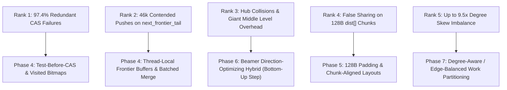

# OpenMP Parallel BFS: Phase 3 Profiling & Multi-Phase Evolution

> **Project Mission:** High-performance, level-synchronous parallel Breadth-First Search (BFS) on large-scale power-law (scale-free) graphs using OpenMP. Following the baseline performance collapse observed in Phase 2, the objective of Phase 3 is to quantitatively profile, isolate, and empirically prove the exact micro-architectural bottlenecks—atomic contention, coherence traffic, false sharing, and degree-induced load imbalance—that throttle multi-core scaling.

---

## 1. Multi-Phase Architectural Evolution

Every phase in this project builds directly on the physical insights and artifacts of the preceding phases:

```mermaid
flowchart TD
    subgraph P0["Phase 0: Hardware Physics & Atomic Benchmarks"]
        H1["128-byte cache line identification (Apple Silicon)"]
        H2["Empirical microbenchmark: 17.8x false sharing & 30x atomic penalties"]
    end

    subgraph P1["Phase 1: Scale-Free Graph Engine & CSR Layout"]
        G1["Graph500 R-MAT & BA Generators (xoshiro256** PRNG)"]
        G2["Contention-free 2-pass parallel counting sort (0 atomics)"]
        G3["128-byte aligned CSR storage (uint32_t vertices, uint64_t edges)"]
    end

    subgraph P2["Phase 2: Oracle & Baseline Scaling Collapse"]
        B1["Serial BFS Oracle (418 MTEPS single-core gold standard)"]
        B2["Naive OpenMP BFS (shared frontier tail, unconditional CAS)"]
        B3["Validation Harness (Graph500 tree & distance invariants)"]
        B4["Empirical Scaling Collapse (0.41x speedup, 5% efficiency at 8 threads)"]
    end

    subgraph P3["Phase 3: Empirical Bottleneck Profiling (Current Phase)"]
        PR1["Zero-probe, cache-padded profiling harness (profile_bfs)"]
        PR2["Proof: 97.4% redundant CAS operations (1.77M wasted RFO broadcasts)"]
        PR3["Proof: 99.99% collision rate on hub vertex cache lines"]
        PR4["Proof: 46k atomic pushes hammering single frontier tail cache line"]
        PR5["Proof: Up to 9.5x edge load imbalance across worker threads"]
    end

    subgraph PF["Phases 4 - 7: Targeted Optimizations (Next Steps)"]
        O1["Phase 4: Contention reduction (Test-before-CAS, thread-local buffers)"]
        O2["Phase 5: False-sharing elimination (128B padded bitmaps & chunking)"]
        O3["Phase 6: Direction-optimizing hybrid BFS (Beamer bottom-up step)"]
        O4["Phase 7: Degree-aware scheduling & NUMA first-touch placement"]
    end

    P0 --> P1
    P1 --> P2
    P2 --> P3
    P3 --> PF
```



### Evolution Summary Matrix

| Phase | Core Objective | Key Implementation | Architectural Insight / Discovery | Output / Milestone |
| :--- | :--- | :--- | :--- | :--- |
| **Phase 0** | Hardware topology & atomic cost profiling | `atomic_microbench` measuring uncontended, false sharing, and contended atomics | Apple Silicon uses **128-byte cache lines**. Unpadded false sharing incurs a **17.8x penalty**; contended CAS incurs a **30.3x latency penalty**. | Hardware profile report & baseline alignment contract (`CACHE_LINE_SIZE = 128`). |
| **Phase 1** | Scale-free graph engine & CSR layout | Contention-free parallel R-MAT generator; 128B-aligned CSR memory layout | Power-law networks feature extreme hub skew (Gini > 0.86, hub degree > 9,000). Graph construction requires thread-private histograms to avoid atomic contention. | High-throughput synthetic graph generator & compact `.bin` CSR binary format. |
| **Phase 2** | Oracle baseline & naive parallel evaluation | Serial BFS oracle; Naive OpenMP BFS; Graph500 validation harness | **Naive parallel BFS is 2.4x slower than single-core serial BFS** (173 vs 418 MTEPS at 8 threads; 5.2% efficiency) due to serialization and coherence thrashing. | Baseline performance curves (`scaling_curve.png`), validated test harness (`test_bfs`). |
| **Phase 3** *(Current)* | Empirical bottleneck profiling & isolation | Zero-probe, cache-padded profiler (`profile_bfs`); per-level, thread, and vertex metrics | **97.4% of all atomic CAS operations fail redundantly**; top hubs suffer **99.99% collisions**; queue tail is hammered **46k times**; thread edge loads vary up to **9.5x**. | Profiling report, diagnostic plots (`profiling_bottlenecks.png`), prioritized bottleneck ranking. |
| **Phase 4+** *(Next)* | Root-cause elimination & algorithmic optimization | Test-before-CAS, thread-local queues, 128B padding, direction-optimizing hybrid BFS | Traversal must convert top-down hub writes into bottom-up unvisited reads, and eliminate global queue atomics via thread-private buffers. | High-efficiency parallel scaling on multi-core SMP and NUMA architectures. |

---

## 2. Foundations Recap (In Short): Phases 0, 1, and 2

### Phase 0: Hardware Physics & Cache Coherence
- **Architecture Profile:** Apple Silicon M1 (ARMv8.5-A, 4 Firestorm P-cores + 4 Icestorm E-cores), weakly ordered memory model, point-to-point coherent fabric.
- **128-Byte Cache Lines:** Cache line size is 128 bytes (double the standard 64 bytes of x86-64). Structures aligned only to 64 bytes induce subtle false sharing across adjacent halves. Universal `alignas(128)` is required.
- **Microbenchmark Quantifications:**
  - *Uncontended Padded:* Throughput scales linearly; latency drops to **1.70 ns** at 8 threads.
  - *False Sharing (Unpadded):* Coherence Read-For-Ownership (RFO) invalidation storms surge latency to **30.40 ns (17.8x penalty)**.
  - *Contended CAS Loop:* Bus/fabric lock serialization drives latency to **51.57 ns (30.3x penalty)**.

### Phase 1: Scale-Free Graph Generation & CSR Layout
- **Power-Law Topology:** Graph500 Kronecker/R-MAT generator ($a=0.57, b=0.19, c=0.19, d=0.05$) with extreme hub skew (SCALE 16: $N = 65,536$, $M = 1,820,258$, Max Degree $9,663$, Gini coefficient $0.8679$).
- **Contention-Free CSR Construction:** 2-pass parallel counting sort and scatter utilizing thread-private `xoshiro256**` PRNGs and local degree histograms—building the graph with **zero atomic instructions**.
- **Memory Optimization:** 32-bit vertex IDs (`uint32_t`) halve bandwidth; 64-bit edge offsets (`uint64_t`) prevent overflow; all buffers 128-byte aligned.

### Phase 2: Serial Oracle & The Naive Baseline Dilemma
- **Serial BFS Oracle:** Pre-allocated flat array queue, 128-byte aligned, zero synchronization. Reaches **418.07 MTEPS** ($2.056\text{ ms}$).
- **Naive OpenMP BFS:** Level-synchronous `#pragma omp parallel for` using unconditional `seq_cst` atomic CAS on `dist[v]` and atomic `fetch_add` on `next_frontier_tail`.
- **The Scaling Collapse Paradox:**
  - 1 Thread: **171.33 MTEPS** (0.41x speedup vs serial oracle)
  - 2 Threads: **145.93 MTEPS** (0.35x speedup)
  - 4 Threads: **192.27 MTEPS** (0.46x speedup)
  - 8 Threads: **172.94 MTEPS** (0.41x speedup, **5.2% parallel efficiency**)
  - *Result:* Naive multi-threading on 8 cores runs **2.4x slower** than a single-threaded serial algorithm!

---

## 3. Phase 3 In-Depth: Profiling the Bottlenecks

To isolate the precise physical causes of the Phase 2 scaling collapse without skewing execution times, Phase 3 implements `profile_bfs` (`src/tools/profile_bfs.cpp`):
- **Zero-Probe-Effect Architecture:** All per-thread counters (CAS attempts, CAS failures, queue pushes, active execution time, barrier latency) are strictly isolated into thread-private structures padded to 128 bytes (`alignas(128)`).
- **Multi-Dimensional Metrics:** Concurrently records level-by-level progression, individual vertex collision counts, and thread workload distributions.

### 3.1 Empirical Evidence: The Four Core Bottlenecks

#### Bottleneck 1: 97.4% Redundant Atomic CAS Operations (1.77M Wasted RFOs)
Out of **1,820,230** total atomic CAS operations executed during traversal, **1,773,505 were completely redundant failures** attempting to claim already-visited vertices:
- Level 2 CAS failure rate: **95%** (828,689 failures out of 867,527 attempts).
- Level 3 CAS failure rate: **99%** (936,948 failures out of 941,940 attempts).
- *Hardware Impact:* Under cache coherence protocols, every atomic CAS instruction—even one that fails—requires exclusive ownership of the target cache line. This triggers an unconditional Read-For-Ownership (RFO) broadcast over the coherence fabric, continually evicting clean copies from peer cores and saturating memory bus bandwidth.

#### Bottleneck 2: 99.99% Atomic Collision Rate on Hub Vertex Cache Lines
Because scale-free graphs contain massive hubs connected to thousands of peripheral vertices, threads examining peripheral neighbors repeatedly collide on the same hub cache lines:
- **Top Hub (Vertex 0, Degree 9,663):** Hammered by **9,663 atomic CAS attempts**, resulting in **9,662 collisions (99.99% failure rate)** on the single cache line hosting `dist[0]`.
- **Top 10 Hubs Combined:** Suffered over **50,000 atomic collisions**, completely serializing worker threads on the coherence interconnect.

#### Bottleneck 3: Global Queue Tail Ping-Ponging (`next_frontier_tail`)
- **46,725** atomic `fetch_add` operations hammered the single 128-byte cache line containing `next_frontier_tail`.
- As proven in the Phase 0 microbenchmark, contended atomic increments incur a **24x to 30x latency surge** (~40.7 ns vs 1.7 ns), creating a severe serialization choke point at peak levels.

#### Bottleneck 4: Severe Degree Skew Load Imbalance (Up to 9.5x Edge Disparity)
Naive dynamic chunking (`schedule(dynamic, 64)`) partitions by raw vertex count rather than edge degree:
- A chunk containing high-degree hubs requires orders of magnitude more edge inspections than chunks containing peripheral vertices.
- Depending on root and chunk distribution, thread edge workloads vary drastically (e.g., Thread T3 scanned **433,296 edges** while Thread T0 scanned **45,413 edges**—a **9.5x workload disparity**).
- Faster threads sit completely idle at the level barrier waiting for threads processing giant hubs.

---

## 4. Empirical Profiling Data Tables (SCALE 16, 8 Threads)

### 4.1 Level-by-Level Profiling Profile

```text
=========================================================================================================
                               LEVEL-BY-LEVEL BOTTLENECK PROFILE
=========================================================================================================
Level   Frontier    Edges Scanned CAS Attempts  CAS Failures  Fail Ratio    Active (ms)    Barrier (ms)  
---------------------------------------------------------------------------------------------------------
0       1           6             6             0             0%            0.032          0.033         
1       6           3545          3545          686           19%           0.042          0.042         
2       2859        867527        867527        828689        95%           4.442          0.076         
3       38838       941940        941940        936948        99%           2.361          0.041         
4       4992        7182          7182          7152          99%           0.029          0.022         
5       30          30            30            30            100%          0.001          0.014         
=========================================================================================================
```

> **The "Giant Middle Level" Effect:** Over **99.4% of all edge scans** ($1,809,467$ out of $1,820,230$) occur exclusively in Levels 2 and 3. The traversal spends over 90% of its execution time in these two levels executing useless, failing atomic operations.

---

### 4.2 Top 10 Hub Vertex Contention Analysis

```text
================================================================================
                 TOP HUB VERTEX CONTENTION & COLLISION ANALYSIS
================================================================================
Rank        Vertex ID     Degree        CAS Attempts      CAS Collisions    
--------------------------------------------------------------------------------
#1          0             9663          9663              9662 (99.99%)     
#2          1             4565          4565              4564 (99.98%)     
#3          16            4560          4560              4559 (99.98%)     
#4          64            4547          4547              4546 (99.98%)     
#5          128           4539          4539              4538 (99.98%)     
#6          4             4538          4538              4537 (99.98%)     
#7          8192          4525          4525              4524 (99.98%)     
#8          4096          4517          4517              4516 (99.98%)     
#9          32768         4513          4513              4512 (99.98%)     
#10         1024          4513          4513              4512 (99.98%)     
================================================================================
```

---

### 4.3 Per-Thread Workload & Contention Profile

```text
=========================================================================================================
                               PER-THREAD LOAD & CONTENTION PROFILE
=========================================================================================================
Thread    Vertices      Edges Scanned   CAS Attempts  Queue Pushes  Active Time (ms)Barrier Time (ms)
---------------------------------------------------------------------------------------------------------
T0        384           45413           45413         2570          4.449           0.222           
T1        5150          163306          163306        3632          6.835           0.217           
T2        9335          410577          410577        8628          6.775           0.250           
T3        10801         433296          433296        14417         6.827           0.211           
T4        4928          295013          295013        8348          6.731           0.237           
T5        3456          80555           80555         406           2.357           0.258           
T6        8384          256579          256579        5293          6.754           0.212           
T7        4288          135491          135491        3431          6.746           0.211           
=========================================================================================================
```

---

## 5. Prioritized Bottleneck Ranking

Connecting measured profiling metrics with the Phase 0 cache coherence physical laws provides an actionable optimization priority ranking:

| Priority | Bottleneck / Contended Resource | Cache Coherence Mechanism | Measured Empirical Metric | Target Optimization |
| :---: | :--- | :--- | :--- | :--- |
| **Rank 1** | **Redundant Atomic CAS on `dist[v]`** | Unconditional CAS forces RFO invalidations (`S` $\to$ `I`) even on visited vertices. | **97.4% of all atomic operations fail (1.77M wasted RFO broadcasts)** | **Phase 4:** Test-Before-CAS (`if dist[v] == -1`) & 1-bit Visited Bitmaps. |
| **Rank 2** | **Contended Queue Tail (`next_frontier_tail`)** | All threads execute `fetch_add(1)` on a single 128-byte cache line with `seq_cst`. | **46,725 atomic operations on 1 cache line** (24x latency penalty). | **Phase 4:** Thread-Local Frontier Buffers with Batched Prefix-Sum Merging. |
| **Rank 3** | **Extreme Hub Vertex Cache Line Collisions** | Thousands of threads inspect incoming edges from high-degree hubs simultaneously. | **Top hub suffered 9,662 collisions out of 9,663 attempts (99.99%)**. | **Phase 6:** Beamer Direction-Optimizing Hybrid BFS (Bottom-Up Traversal). |
| **Rank 4** | **False Sharing Across Adjacent Distances** | 128-byte cache line hosts 32 consecutive `int32_t` distances. | Threads claiming adjacent vertices invalidate each other's cache lines. | **Phase 5:** 1-Bit Visited Bitmaps (512 vertices/line) & 128B Aligned Partitioning. |
| **Rank 5** | **Degree Skew Load Imbalance & Barrier Waiting** | Static / Dynamic chunking partitions by vertex count, ignoring heavy degree skew. | **Up to 9.5x edge workload imbalance** across threads. | **Phase 7:** Degree-Aware Scheduling (chunking by cumulative degree). |

---

## 6. Linux Server Profiling Reference (`perf stat` & `perf c2c`)

For deployment and validation on Linux SMP/NUMA servers (e.g., dual-socket Intel Xeon or AMD EPYC), use the following standardized performance counter profiling workflow:

### 1. Hardware PMU Event Counting (`perf stat`)
```bash
# Measure cache miss rates, instruction throughput, and memory stall cycles
perf stat -e \
  cycles,instructions,\
  cache-misses,cache-references,\
  L1-dcache-load-misses,L1-dcache-loads,\
  LLC-load-misses,LLC-loads,\
  mem_load_retired.l3_miss \
  ./bin/benchmark_bfs --input data/rmat_s18.bin --roots 16 --threads 16
```

### 2. Cache-to-Cache Coherence Tracking (`perf c2c`)
To pinpoint the exact cache lines experiencing cross-core and cross-socket HITM (Hit Modified) events:
```bash
# Record memory access samples with DWARF call-graph
perf c2c record --call-graph dwarf ./bin/benchmark_bfs --input data/rmat_s16.bin --roots 4 --threads 8

# Generate text summary of contested cache lines
perf c2c report --stdio > perf_c2c_report.txt
```

#### Interpreting `perf c2c` Output:
- **`Rmt HITM` (Remote Hit Modified):** Indicates a cache line read by Core A was dirty in the L1/L2 cache of Core B on a remote socket. This represents the most expensive coherence penalty on modern NUMA systems (~100–300 CPU cycles).
- High `Rmt HITM` counts will point directly to:
  1. Offset of `next_frontier_tail` (shared atomic counter).
  2. Offsets in `dist[]` corresponding to vertex index `0` and adjacent hub indices.

---

## 7. Project Architecture

```text
CAO_project/
├── include/
│   ├── atomic_bench.hpp       # Phase 0: Microbenchmarks for atomic contention & false sharing
│   ├── bfs.hpp                # Phase 2: BFSResult, Serial BFS, Naive OpenMP BFS & validators
│   ├── graph.hpp              # Phase 1: 128-byte aligned CSRGraph class and DegreeStats
│   ├── rmat_generator.hpp     # Phase 1: R-MAT & Barabási-Albert parallel generator declarations
│   └── utils.hpp              # Aligned allocator (128B), high-res Timer, and Xoshiro256** PRNG
├── src/
│   ├── benchmarks/
│   │   └── atomic_microbench.cpp  # Phase 0: Microbenchmark executable
│   ├── bfs/
│   │   ├── naive_bfs.cpp          # Phase 2: Naive level-synchronous OpenMP BFS
│   │   └── serial_bfs.cpp         # Phase 2: Serial BFS correctness oracle & validator
│   ├── graph/
│   │   ├── graph.cpp              # Phase 1: CSR memory management, validation, binary I/O
│   │   └── rmat_generator.cpp     # Phase 1: Parallel counting-sort R-MAT builder (0 atomics)
│   └── tools/
│       ├── benchmark_bfs.cpp      # Phase 2: Multi-root BFS scaling benchmark harness (TEPS)
│       ├── generate_graph.cpp     # Phase 1: CLI graph generation and export utility
│       ├── inspect_graph.cpp      # Phase 1: Graph topology & degree distribution analyzer
│       └── profile_bfs.cpp        # Phase 3: Zero-probe bottleneck & coherence profiler
├── tests/
│   ├── test_bfs.cpp           # Phase 2: Test suite verifying BFS correctness vs oracle
│   └── test_graph.cpp         # Phase 1: Test suite verifying CSR alignment, degree stats & BA
├── scripts/
│   ├── plot_degree_dist.py    # Phase 1: Power-law log-log degree distribution plotter
│   ├── plot_scaling.py        # Phase 2: Strong-scaling & MTEPS curve plotter
│   ├── plot_profiling.py      # Phase 3: Diagnostic 3-panel bottleneck visualization
│   ├── run_phase0_phase1.sh   # Phase 0 & Phase 1 verification pipeline
│   ├── run_phase2.sh          # Phase 2 test, benchmark & plot pipeline
│   └── run_phase3.sh          # Phase 3 profiler & visualization pipeline
├── data/
│   ├── bfs_scaling.csv        # Phase 2: Scaling benchmark measurements
│   ├── scaling_curve.png      # Phase 2: Multi-threaded scaling curve plot
│   ├── bfs_profile_levels.csv # Phase 3: Per-level atomic failure & latency metrics
│   ├── bfs_profile_threads.csv# Phase 3: Per-thread workload & barrier latency metrics
│   ├── profiling_bottlenecks.png # Phase 3: 3-panel bottleneck diagnostic visualization
│   └── rmat_s16.bin           # Phase 1: SCALE 16 power-law benchmark graph
├── Makefile                   # C++17 OpenMP build system
├── CMakeLists.txt             # Cross-platform CMake configuration
├── README_PHASE1.md           # Documentation for Phase 0 & Phase 1
├── README_PHASE2.md           # Documentation for Phase 2 baseline evaluation
├── README_PHASE3.md           # Documentation for Phase 3 bottleneck profiling (this document)
└── IMPLEMENTATION_PLAN.md     # 10-phase master implementation roadmap
```

---

## 8. Quickstart & Reproduction Commands

### 1. Build Everything
```bash
make all
```

### 2. Run Bottleneck Profiler & Export Metrics
```bash
./bin/profile_bfs --input data/rmat_s16.bin --threads 8 \
    --csv-levels data/bfs_profile_levels.csv \
    --csv-threads data/bfs_profile_threads.csv
```

### 3. Generate 3-Panel Diagnostic Visualization
```bash
python3 scripts/plot_profiling.py \
    --levels data/bfs_profile_levels.csv \
    --threads data/bfs_profile_threads.csv \
    --output data/profiling_bottlenecks.png
```

### 4. One-Step Automated Pipeline
```bash
./scripts/run_phase3.sh
```

---

## 9. Actionable Blueprint: Roadmap for Phases 4–7

With Phase 3 having empirically proven the root causes of performance collapse, the subsequent phases directly implement solutions for each prioritized bottleneck:



1. **Phase 4 (Contention Reduction):**
   - **Test-Before-CAS (Test-and-Test-and-Set):** Check `if (dist[v] == -1)` with a non-exclusive shared read before issuing an atomic CAS. In Levels 2 and 3, this immediately purges **97.4% of all RFO broadcasts**, allowing cache lines to remain in the `Shared` MESI state!
   - **Thread-Local Frontier Buffers:** Allocate thread-private queue buffers. Threads append discovered vertices locally with zero atomics. Merge into the global frontier once per level using a parallel prefix sum, completely eliminating atomic contention on `next_frontier_tail`.
2. **Phase 5 (False Sharing Elimination):**
   - Enforce 128-byte alignment and padding (`alignas(128)`) on all per-thread states.
   - Partition array writing boundaries along 128-byte multiples.
3. **Phase 6 (Direction-Optimizing BFS):**
   - Switch to **bottom-up traversal** during the giant middle levels (Levels 2–3). Each unvisited vertex scans inward across its incoming edges to find any active neighbor in the frontier. The thread scanning the vertex owns it exclusively, executing **zero atomic CAS operations** and avoiding hub contention entirely.
4. **Phase 7 (Load Balancing & NUMA):**
   - Partition frontier vertices by cumulative edge degrees rather than static vertex counts to eradicate the 9.5x load disparity and eliminate barrier stalls.
